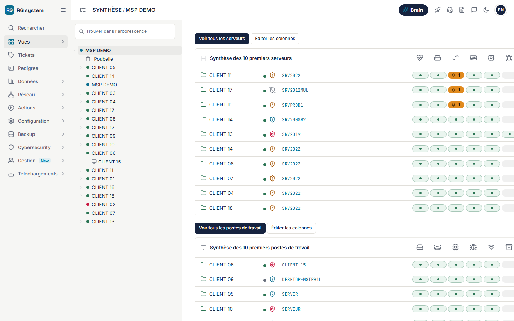
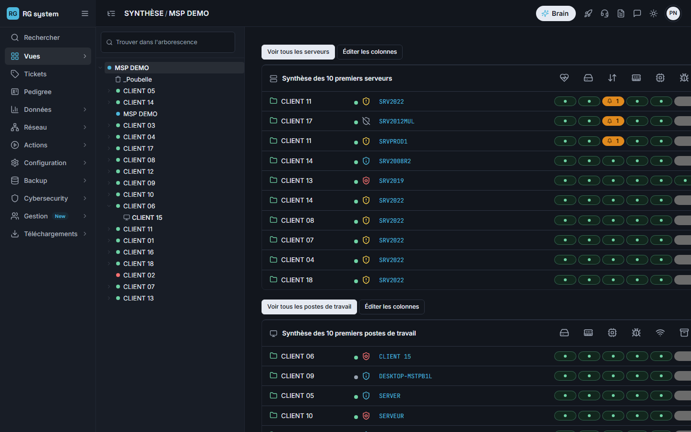
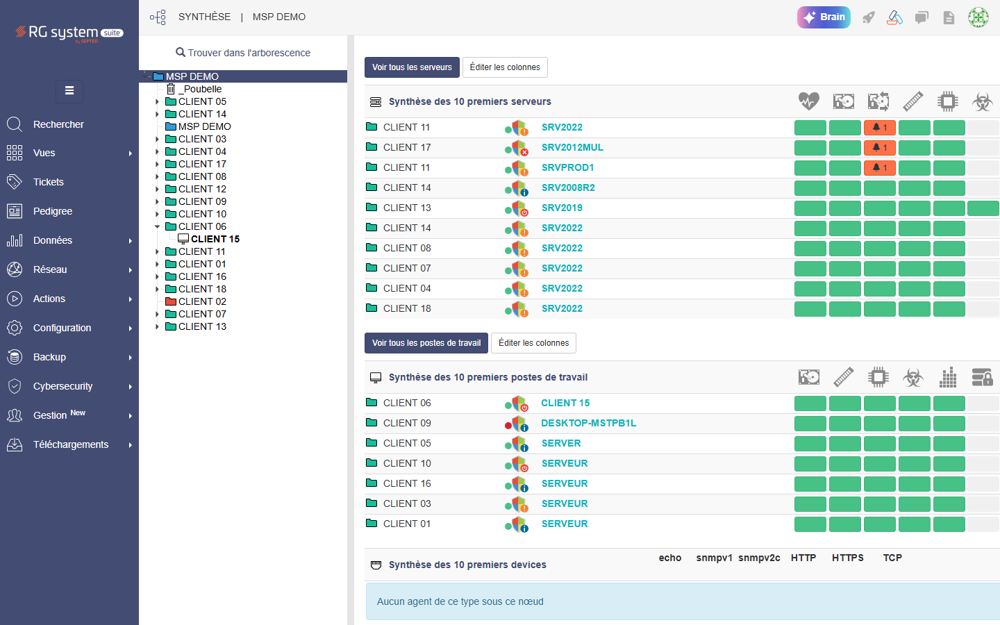
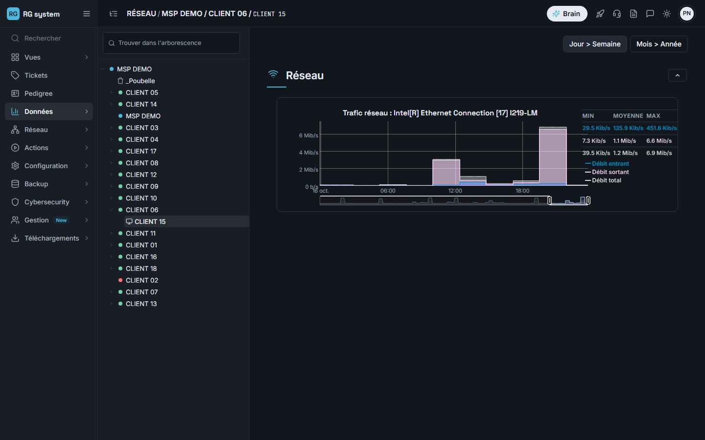
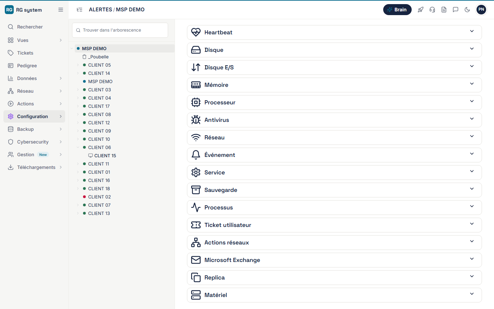
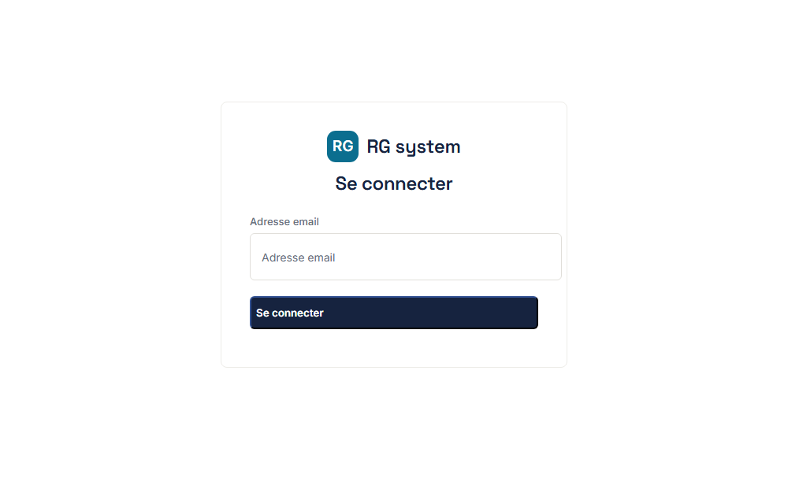
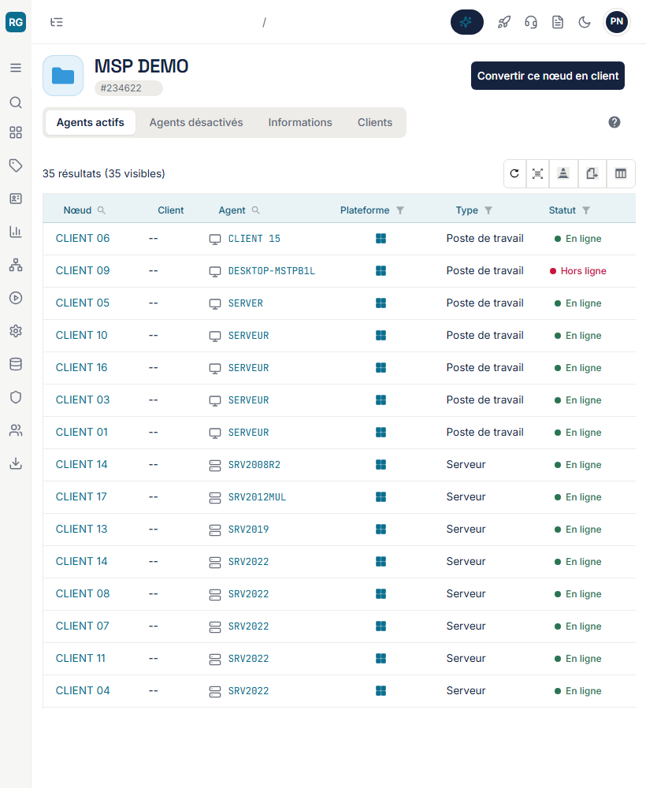
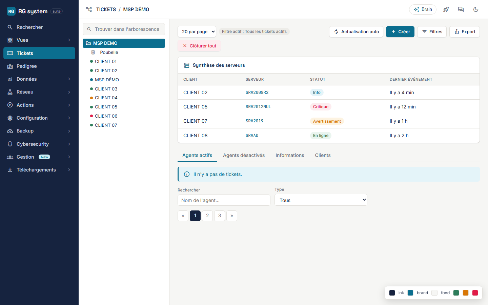

# RG System – thème Arobase

> Un habillage moderne, clair et sombre, pour **RG System Suite** : une extension Edge / Chrome qui ne touche
> qu'à l'affichage. Même plateforme, mêmes données, même comportement : une interface cohérente, lisible et agréable.



| Thème sombre | Interface d'origine |
|---|---|
|  |  |

*Captures de données fictives (nœuds « CLIENT 01… »). Le projet est un **prototype non officiel** : il n'est ni affilié à l'éditeur de RG System ni approuvé par lui.*

## Ce que ça change

- **Le même langage visuel que Webgest**, l'outil interne d'Arobase : typographie (Inter, Space Grotesk, JetBrains Mono), jetons de couleur, aplats sans ombre, icônes (jeu Lucide), pastilles d'état et formulaires identiques sur tous les écrans, en clair et en sombre.
- **Les écrans de RG repris un à un** : barre latérale, arborescence, tableaux de synthèse, fiche agent, tickets, courbes, configuration, sauvegardes, vulnérabilités, gestion, profil, page de connexion… plus un socle générique (Bootstrap 3 + MUI) pour ce qui n'a pas été vu.
- **Des gains d'usage**, tous côté navigateur :
  - arborescence **redimensionnable librement** (la largeur minimale d'origine est supprimée) ;
  - **actualisation automatique des tickets** qui fonctionne vraiment, sans recharger la plateforme ;
  - **notifications Edge** à la création, la relance et la clôture d'un ticket, depuis n'importe quelle page de RG (option, un onglet RG doit rester ouvert) ;
  - **recherche rapide `Ctrl+K`** (nœuds de l'arborescence et pages du menu) ;
  - **texte complet au survol** des libellés tronqués, infobulles sur les actions en simple icône ;
  - panneau de réglages dans l'icône de l'extension : thème, densité, actualisation, largeur de l'arbre ;
  - **adaptation à la largeur d'écran** : RG est conçu pour le bureau (510 px de menu et d'arborescence avant tout contenu) ; le thème réduit le menu en rail d'icônes sous 1200 px, range l'arborescence sous 1000 px (elle s'ouvre en superposition) et passe le menu et l'arborescence en tiroirs sous 768 px, avec un en-tête compact ;
  - infobulles sur le menu (« Pedigree — fiche et inventaire des agents du nœud »), utiles surtout quand le menu est réduit en icônes ;
  - avatar en initiales, courbes lisibles en sombre, squelettes de chargement.
- **Cohérence vérifiée par mesure** : pour chaque élément visible de plus de 60 pages, on compare son style avec et sans le thème ; ce qui gardait le style d'origine (fonds gris, contours, textes sombres sur fond sombre, polices) a été repris, et les familles de tableaux (grilles React, listes Bootstrap, tableaux MUI, lignes-cartes) partagent la même présentation.

| Courbes en sombre | Configuration | Connexion |
|---|---|---|
|  |  |  |



Le style reprend celui de **Webgest**, l'outil interne d'Arobase (style « Obsidian / reading view ») : aplats, aucune ombre ni dégradé, bordures fines, page blanche, menu et arborescence en gris très clair, boutons primaires en encre pleine, onglets en rail, badges point + texte, en-têtes de tableau teintés de la couleur du module (ambre pour les tickets, vert pour les sauvegardes, rose pour la cybersécurité, violet pour la gestion). Le thème sombre reprend les jetons du thème sombre de Webgest. La maquette de départ est conservée dans [`maquette/direction.html`](maquette/direction.html) (ci-dessous, ancienne direction à menu marine).



## Installation (Edge ou Chrome)

1. Télécharger le dernier zip dans les [Releases](../../releases) (ou `npm run build` puis dossier `dist/extension`) et l'**extraire**.
2. Ouvrir `edge://extensions` (ou `chrome://extensions`), activer le **Mode développeur**.
3. **Charger l'extension décompressée** et choisir le dossier extrait.
4. Recharger RG System (Ctrl+F5). La console (F12) affiche `[RG thème Arobase] extension démarrée…`.

À savoir : l'extension est chargée **depuis le dossier** (ne pas le déplacer). Edge peut proposer de désactiver les extensions du mode développeur au démarrage : refuser, ou la réactiver dans `edge://extensions`. Un déploiement à plusieurs passe par le Microsoft Edge Add-ons store ou une stratégie d'entreprise.

## Utilisation

Cliquer sur l'icône de l'extension ouvre le panneau de réglages. Raccourcis :

| Raccourci | Action |
|---|---|
| `Alt+Maj+T` | Clair ↔ sombre (par défaut : suit le réglage du système) |
| `Alt+Maj+D` | Densité des tableaux : confortable ↔ compacte |
| `Ctrl+K` | Recherche rapide : nœuds chargés dans l'arborescence et pages du menu |
| Double-clic sur la poignée de l'arbre | Retour à la largeur d'origine |

Les réglages sont mémorisés dans le `localStorage` du site (`rgx.*`). Interrupteur général (en cas de régression après une mise à jour de RG) : désactiver le thème dans le panneau de l'extension.

## Vie privée et sécurité

- L'extension ne s'exécute **que** sur `https://dashboard.rg-supervision.com/*`.
- **Aucune donnée n'est envoyée ailleurs**, aucune télémétrie. Polices, icônes et CSS sont embarqués : pas de CDN.
- **Un seul appel réseau ajouté, et seulement si vous activez les notifications de tickets** (désactivées par défaut) : la même requête que celle que RG envoie pour afficher la page des tickets (`GET /action/page/ticket?node=…`, même site, session en cours), toutes les 60 s. La réponse est lue sur place, comparée à la précédente, et seuls des textes de notification en sortent, vers Edge. Rien n'est transmis à un tiers.
- Elle ne modifie ni les URL, ni les requêtes, ni les données : uniquement du CSS et un peu de JavaScript d'affichage.
- Permissions : accès au domaine ci-dessus, `scripting` / `activeTab` pour le panneau de réglages, `notifications` pour les notifications de tickets.
- Détail et procédure de signalement : [SECURITY.md](SECURITY.md).

## Limites connues

- **Rechargements périodiques de la plateforme** : avec le SSO Microsoft 365, RG System recharge entièrement la page toutes les 2 à 3 minutes (renouvellement de la session par redirection vers Microsoft). Ce comportement existe **sans l'extension** (mesuré onglet inactif) et disparaît avec une connexion par mot de passe RG : il vient du renouvellement de session, pas du thème. Voir [docs/PROPOSITION-RG.md](docs/PROPOSITION-RG.md).
- **Courbes** (canvas dygraphs) : les couleurs des séries sont choisies pour un fond blanc ; en sombre elles sont inversées avec rotation de teinte (reconnaissables, pas identiques).
- **Contenus externes** : le widget « Nouveautés » et l'application Brain sont des applications distinctes, seul leur tiroir est habillé.
- **Petits écrans** : la coque (menu, arborescence, en-tête) est adaptée, et les pages les plus simples tiennent dans 390 px ; les écrans très denses (assistants, grandes grilles) défilent horizontalement dans la zone de contenu.
- **Fenêtres modales** et quelques états rares (erreurs, confirmations) sont stylés d'après les composants Bootstrap/MUI mais n'ont pas tous été vus en conditions réelles.
- Après une mise à jour de RG System, un écran peut perdre son habillage : voir [Ajouter ou corriger un écran](docs/DEVELOPPEMENT.md#ajouter-ou-corriger-un-écran). Les sélecteurs fragiles sont regroupés en tête de `content.js` (objet `SEL`).

## Pour les développeurs

```bash
npm install
npm run build   # dist/extension/
npm test        # contrôles automatiques (manifest, CSS sans ressource externe, règles sous html[data-rgx], contrastes AA)
npm run serve   # banc de test local : http://localhost:4173/
```

Architecture, ajout d'un écran, banc de test et tests : [docs/DEVELOPPEMENT.md](docs/DEVELOPPEMENT.md).
Contribuer : [CONTRIBUTING.md](CONTRIBUTING.md). Historique : [CHANGELOG.md](CHANGELOG.md).
Pour l'équipe de RG System : [docs/PROPOSITION-RG.md](docs/PROPOSITION-RG.md) (ce que l'éditeur pourrait intégrer nativement) et [docs/PROPOSITION-TEXTES.md](docs/PROPOSITION-TEXTES.md) (titres, libellés, orthographe et cohérence des textes relevés sur 49 pages).

## Licence et crédits

[MIT](LICENSE) © 2026 Arobase. Polices Inter, Space Grotesk et JetBrains Mono (OFL), tracés d'icônes Lucide (ISC), Tailwind CSS (MIT) : voir [THIRD-PARTY-NOTICES.md](THIRD-PARTY-NOTICES.md).
« RG System » et « RG System Suite » appartiennent à leur éditeur ; ce projet est un habillage non officiel.
